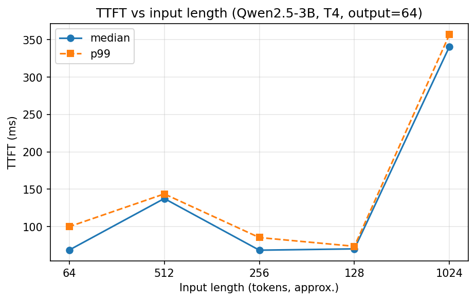
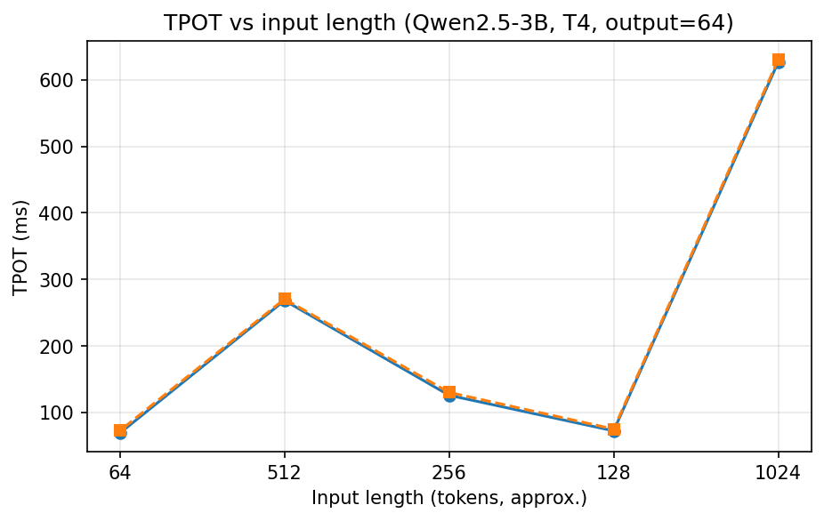
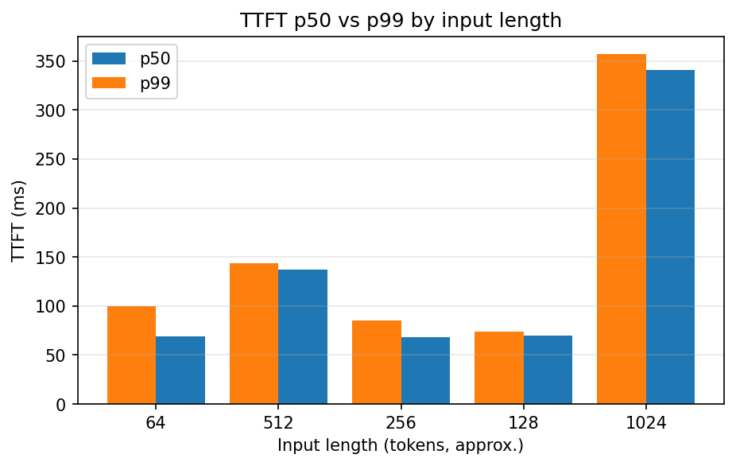

# LLM Inference Latency on a T4: A Minimal Measurement

A small, reproducible measurement of TTFT and TPOT for a 3B-class LLM
on a Kaggle Tesla T4, as a function of input length.

## Motivation

TTFT (time to first token) and TPOT (time per output token) are the two
numbers that determine LLM serving quality. This project measures both
on consumer-grade hardware and checks whether the observed trends match
the expected compute-bound (prefill) / bandwidth-bound (decode) model.

## Setup

| | |
|---|---|
| Model | Qwen/Qwen2.5-3B-Instruct, FP16 |
| Hardware | Tesla T4 (Kaggle, 15GB, sm75) |
| Backend | HuggingFace `transformers`, manual KV-cache loop |
| Input lengths | 64, 128, 256, 512, 1024 tokens (word-count approximation) |
| Output length | fixed at 64 tokens |
| Samples | 10 per input length, 50 total |
| Warm-up | 3 iterations before measurement |

## Results

| Input length | TTFT median | TPOT median |
|---|---|---|
| 64 | 71.2 ms | 71.6 ms |
| 128 | 70.7 ms | 70.5 ms |
| 256 | 71.5 ms | 116.2 ms |
| 512 | 121.9 ms | 242.1 ms |
| 1024 | 301.1 ms | 554.0 ms |

**Both TTFT and TPOT rise with input length, but for different reasons.**

- **TTFT rises ~4.2×** from 64 to 1024 tokens (71 ms → 301 ms).
  Consistent with prefill being compute-bound: more input tokens means
  more matrix-multiply work before the first output token.
- **TPOT rises ~7.7×** over the same range (72 ms → 554 ms). The likely cause is
  that each decode step attends over the full KV cache in O(n^2), whose size grows
  with input length. This could be reduced in vLLM with PagedAttention.
- **p99 TTFT grows faster than p50**, i.e. long inputs widen the tail
  more than they shift the median.

**Takeaway**: the naive picture "TTFT = prefill, TPOT = decode, only TTFT
depends on input length" is incomplete. KV-cache attention makes TPOT
input-length-dependent too — less steeply than TTFT in an optimized
engine, but clearly in an unoptimized one.

| TTFT vs input | TPOT vs input |
|---|---|
|  |  |

## Reproduce

1. Open `notebook.ipynb` on Kaggle with **GPU T4 x2**.
2. Run all cells. Results are written to `data/my_benchmark_results.csv`.
3. Environment versions are recorded in `env.txt`.

## Limitations

Single model, single GPU, no concurrency, `transformers` backend (no
PagedAttention / continuous batching), word-count input approximation.
See [notes.md](notes.md#limitations) for the full list.

## What I learned

- Why TTFT and TPOT have different bottlenecks (compute vs bandwidth).
- How to design a controlled measurement (one variable at a time).
- Why warm-up matters: the first forward pass was ~32× slower than
  steady state due to CUDA kernel initialization.
- That TPOT is not a constant — KV-cache attention cost makes it grow
  with context length, which the simple bandwidth-bound model hides.